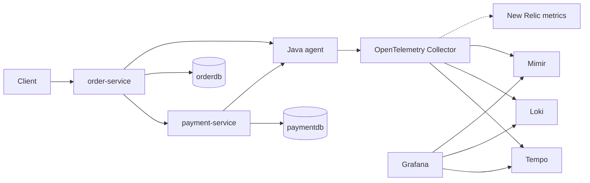

# OpenTelemetry tutorial

A local demo of metrics, logs, and traces. Two Java 17 Spring Boot services take an order and charge it. The OpenTelemetry Java agent, attached on the JVM command line, sends telemetry to a Collector. The Collector stores traces in Tempo, logs in Loki, and metrics in Mimir. Grafana is already wired to all three.

This stack is for a laptop demo. It uses filesystem storage, anonymous Grafana admin access, and a fixed database password.

## Layout

| Path | Contents |
| --- | --- |
| [observability](observability/README.md) | Grafana, Loki, Tempo, and Mimir |
| [services](services/README.md) | Order, Payment, PostgreSQL, and the Collector |
| [docs](docs/otel-newrelic-grafana-migration-strategy.md) | Observability strategy notes |
| [docs](docs/otel-overview.md) | OpenTelemetry overview and architecture |
| [docs](docs/otel-faq.md) | OpenTelemetry FAQ |

The service guide describes the REST APIs, payment latency, and the spans inside one order. The observability guide describes the backend ports and readiness checks.

## Architecture



The dashed line is a second metrics destination. It is present in the Collector config and left commented, so this demo still sends metrics only to Mimir. A pipeline `exporters` list can name more than one destination. Uncomment `otlp_http/newrelic` in [services/otel-collector/config.yaml](services/otel-collector/config.yaml) and set `NEW_RELIC_LICENSE_KEY` to send the same metrics to New Relic as well.

Order saves a `PENDING` row, calls Payment, then marks the order `PAID` or `FAILED`. About 7 in 10 payments approve in under 100 ms, about 2 in 10 take up to 2 seconds, and about 1 in 10 are declined.

## Start

Use Docker in WSL, or Docker Desktop with the WSL integration enabled. Start the backends first. They create the Docker network the services join.

```bash
cd observability
docker compose up -d

cd ../services
docker compose up -d --build
bash place-orders.sh 20
bash get-orders.sh 20
```

| Surface | URL |
| --- | --- |
| Grafana | http://localhost:3000 |
| Order and Payment dashboard | http://localhost:3000/d/otel-order-payment/order-and-payment |
| Order API | http://localhost:8081 |
| Payment API | http://localhost:8082 |

Grafana signs you in as an anonymous admin. The login form also accepts `admin` / `admin`.

Headline counts on the dashboard are totals since each JVM started. Charts, logs, and traces follow the time picker, so leave it on the last few hours after placing orders.

## Stop

```bash
cd services && docker compose down
cd ../observability && docker compose down
```

`docker compose down -v` in `services` also drops the PostgreSQL volume. `docker compose down` in `observability` discards ingested telemetry.
