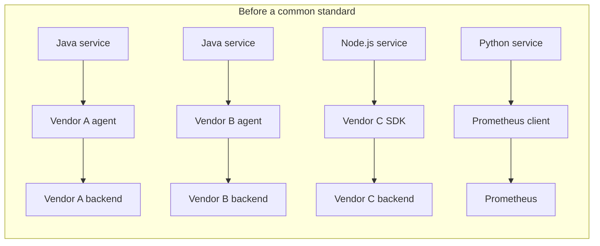
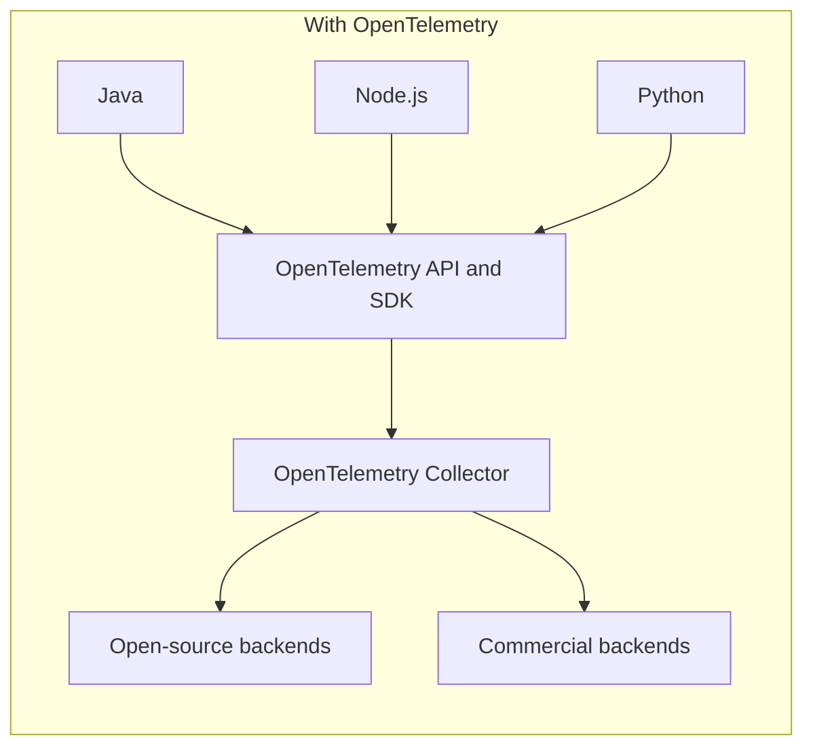
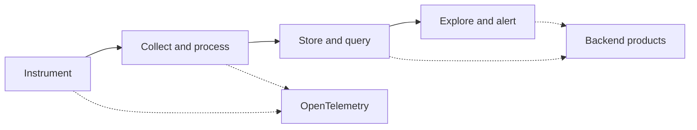
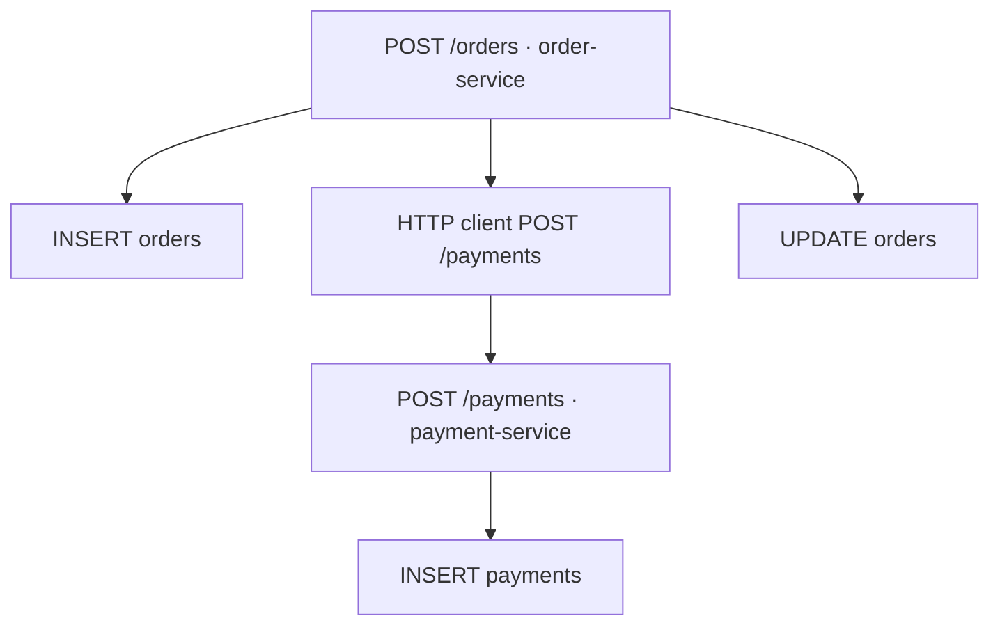
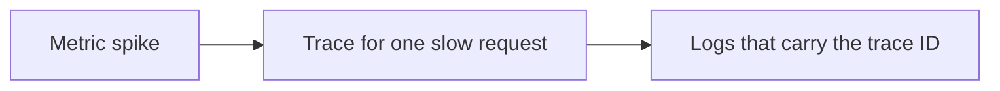
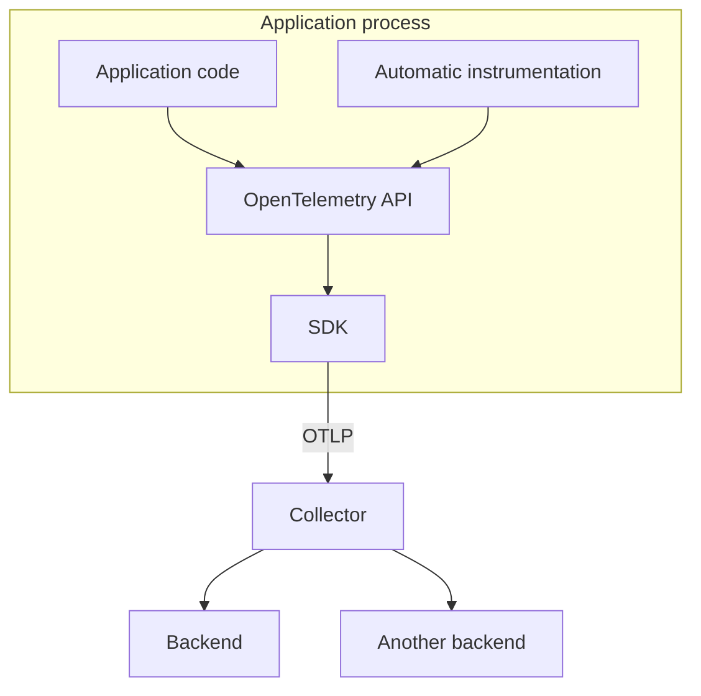
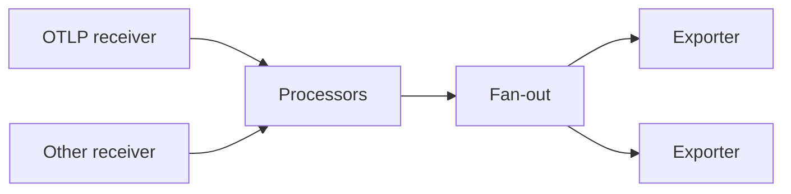
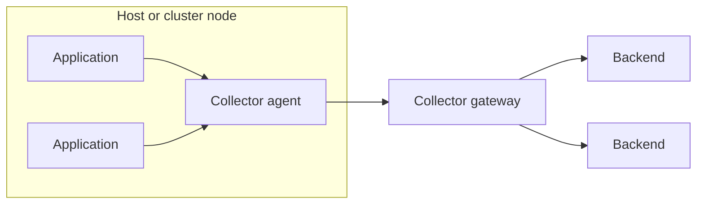

# OpenTelemetry overview

OpenTelemetry is an open-source observability framework. It defines how applications generate traces, metrics, and logs, and how that telemetry is collected and exported. It is vendor-neutral. Storage, query, alerting, and dashboards stay in other products.

The project is part of the Cloud Native Computing Foundation. It merged two earlier efforts, OpenTracing and OpenCensus, which were both trying to standardize instrumentation and export.

Official references used for this overview:

- [What is OpenTelemetry?](https://opentelemetry.io/docs/what-is-opentelemetry/)
- [Collector architecture](https://opentelemetry.io/docs/collector/architecture/)
- [OpenTelemetry concepts](https://opentelemetry.io/docs/concepts/)

The diagrams below are original. They follow the component model on those pages.

## The problem it solves

A distributed system answers three different questions during an incident. Metrics show that latency or errors changed. Logs show what one process recorded. A trace shows which service, call, or query the time was spent in. Those signals are hard to use together when each language and each vendor emits them in its own format.



Each arrow is a different library, a different set of names, and often a different trace context. Moving a service from one backend to another means changing application code or swapping a proprietary agent. Two teams instrumenting the same HTTP server can emit different metric names for the same measurement.

OpenTelemetry separates generating telemetry from storing it.



Two results follow from that split. The organization owns the telemetry it produces and can route it to more than one backend. Application teams learn one API and one set of semantic conventions, regardless of language.

## What it is

OpenTelemetry covers instrumentation and collection. A backend still stores and visualizes the data.



| Piece | Role |
| --- | --- |
| Specification | Behavior of the API, SDK, and data model |
| OTLP | The wire protocol for traces, metrics, and logs |
| Semantic conventions | Shared names for HTTP, databases, messaging, and resources |
| API | Interfaces an application or library calls to record telemetry |
| SDK | Implementation that samples, batches, and exports |
| Instrumentation libraries | Per-framework packages that call the API |
| Automatic instrumentation | Agents or launchers that attach those libraries without application changes |
| Collector | A process that receives, processes, and exports telemetry |

The API records nothing on its own. The SDK, usually installed by an agent, a language launcher, or an application dependency, is what exports. A library should depend on the API and leave the SDK to the host application.

## How a request becomes a trace

A trace is one distributed operation. A span is one timed piece of that operation. Spans nest. The client call and the server handler share a trace ID. Each span has its own span ID.



Context has to travel with the request. On HTTP, the usual carrier is the W3C `traceparent` header. The calling service injects the current trace ID and span ID. The receiving service extracts them and starts its server span as a child. The same idea applies to messaging, with the context stored on the message.

Logs and metrics join that picture when they carry the same trace ID and the same resource identity, such as `service.name`. A metrics backend can then link a sample to a trace, and a log store can open the trace for a log line.



## Architecture



Automatic instrumentation and hand-written API calls share one SDK. The SDK is responsible for sampling, batching, and the exporter. OTLP is the protocol on the wire. It has a gRPC form, conventionally port 4317, and an HTTP form, conventionally port 4318.

Semantic conventions keep those streams comparable. An HTTP server duration is `http.server.request.duration` in every language that follows the current conventions, with the same attribute names for method, route, and status code.

## Collector

The Collector is a separate binary. Receivers accept telemetry, processors transform or drop it, and exporters send it onward. A pipeline is one path for one signal: traces, metrics, or logs. A receiver can feed more than one pipeline. The last processor fans out, and every exporter in that pipeline receives the data.



Processors run in order. They can add or remove attributes, batch, limit memory, sample, or drop. The same processor name in two pipelines is two instances. They share configuration and keep separate state.

```yaml
service:
  pipelines:
    traces:
      receivers: [otlp]
      processors: [memory_limiter, batch]
      exporters: [otlp]
    metrics:
      receivers: [otlp]
      processors: [memory_limiter, batch]
      exporters: [otlp]
```

Two deployments are common.

An **agent** runs next to the application, on the same host, as a sidecar, or as a daemon on a node. The application exports to that local Collector. The agent can then forward, batch, and enrich before anything crosses the network.

A **gateway** is a remote Collector. Applications or agents export to it, and it fans out to backends. One gateway configuration can send the same stream to an open-source store and a commercial product.



Applications can also export straight to a backend that accepts OTLP. The Collector is the place to change routing, sampling, and destinations without redeploying the application.

## What it leaves to other systems

OpenTelemetry does not store telemetry, evaluate alert rules, or draw dashboards. Those stay in the products at the end of the exporters. It also does not decide the sampling or retention policy for an organization. The SDK and the Collector provide the controls. The operators choose the settings.
