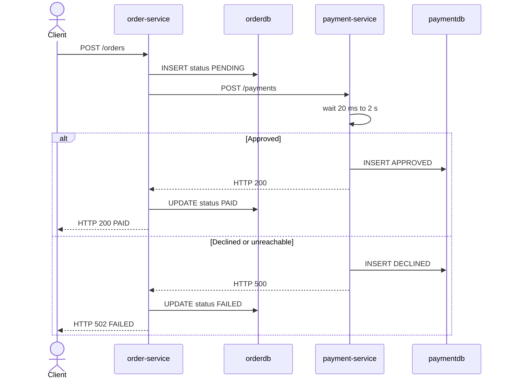
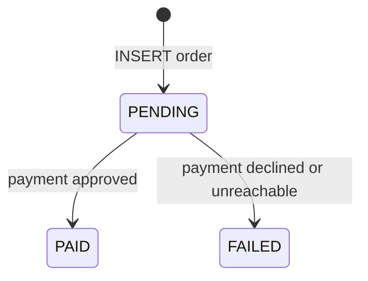
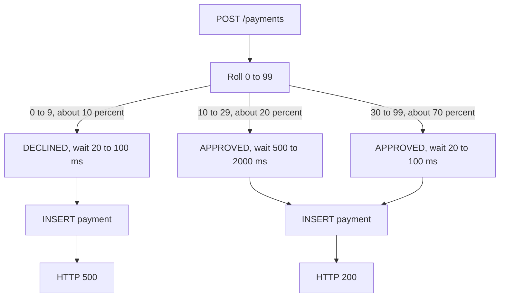
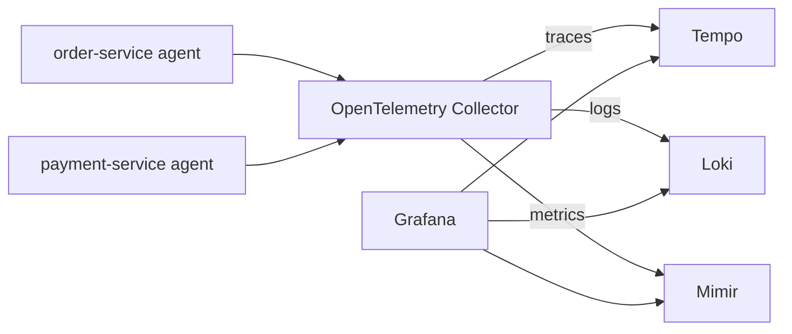
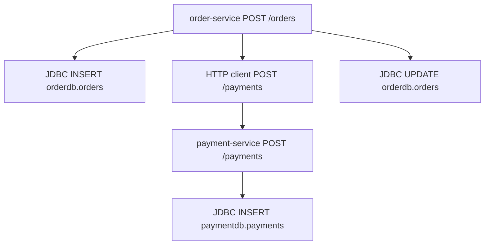

# Order and Payment demo

Two Java 17 Spring Boot services take an order, charge it through a second service, and store each side in its own PostgreSQL database. A Java agent on each JVM sends traces, logs, and metrics to an OpenTelemetry Collector, which forwards them to Tempo, Loki, and Mimir.

## What the services do

**order-service** (`http://localhost:8081`) accepts an order, saves it as `PENDING`, and calls Payment with the order id and amount. When Payment approves the charge, Order updates the row to `PAID` and returns HTTP 200. When Payment declines the charge or cannot be reached, Order updates the row to `FAILED` and returns HTTP 502. The response body is the order either way, including `paymentId` when Payment stored a row.

**payment-service** (`http://localhost:8082`) authorizes one charge. It rolls a random outcome, waits, then inserts the payment. An approval returns HTTP 200. A decline is stored as `DECLINED` and returned as HTTP 500 so the Java agent marks that span as an error.

Each service owns one database on the shared PostgreSQL server:

| Database | Table | Written by |
| --- | --- | --- |
| `orderdb` | `orders` | order-service |
| `paymentdb` | `payments` | payment-service |

`orders` holds `id`, `customer_id`, `sku`, `amount`, `status` (`PENDING`, `PAID`, `FAILED`), `payment_id`, and `created_at`. `payments` holds `id`, `order_id`, `amount`, `status` (`APPROVED`, `DECLINED`), `delay_ms`, and `created_at`.

## Request path



If Payment cannot be reached, there is no payment row. Order still stores `FAILED` with a null `paymentId`.



## Payment outcomes



The wait sits inside the Payment HTTP span, before the `INSERT`. A slow approval shows up as a long Payment span with a short database span underneath it. Payment logs `orderId`, `paymentId`, `status`, and `delayMs`.

## APIs

`POST /orders` body:

```json
{ "customerId": "c-1", "sku": "book", "amount": 42.50 }
```

`customerId` and `sku` must be non-blank, and `amount` must be at least `0.01`. Anything else returns HTTP 400.

`GET /orders/{id}` returns the stored order. `GET /payments/{id}` returns the stored payment. An unknown id returns HTTP 404.

`POST /payments` is what Order calls. Body: `{ "orderId", "amount" }`.

## Telemetry



The agent is attached on the JVM command line in each image. Both processes export OTLP HTTP to `otel-collector:4318`. The Collector batches that data and sends traces to Tempo, logs to Loki, and metrics to Mimir.

A paid order trace looks like this:



On a decline, `POST /orders`, the client call, and `POST /payments` have error status. The SQL spans stay successful because the `FAILED` and `DECLINED` rows were written.

## Run

Start the Grafana stack in `../observability` first. It creates the Docker network this file joins.

```bash
cd /mnt/c/Users/gbhosal/git/opentelemetry-tutorial/observability
docker compose up -d

cd /mnt/c/Users/gbhosal/git/opentelemetry-tutorial/services
docker compose up -d --build
```

| Service | URL |
| --- | --- |
| Order | http://localhost:8081 |
| Payment | http://localhost:8082 |
| PostgreSQL | `localhost:5432`, user `demo`, password `demo`, databases `orderdb` and `paymentdb` |
| Collector OTLP | `localhost:4317` (gRPC), `localhost:4318` (HTTP) |
| Grafana | http://localhost:3000 |

Place one order:

```bash
curl -sS -X POST http://localhost:8081/orders \
  -H 'Content-Type: application/json' \
  -d '{"customerId":"c-1","sku":"book","amount":42.50}'
```

Place a batch so the fast, slow, and declined cases all show up:

```bash
bash place-orders.sh 20
```

The provisioned dashboard is [Order and Payment](http://localhost:3000/d/otel-order-payment/order-and-payment). The headline counts and latency percentiles are totals since each service started. Charts, logs, and traces follow the time picker, so keep it on the last few hours after a batch of orders. Panels cover request volume and HTTP status, server and client latency, the Order to Payment to PostgreSQL edges, SQL span latency, connection pools, JVM, application logs, and recent `POST /orders` traces.

In Grafana Explore:

- Tempo: `{ resource.service.name = "order-service" && name = "POST /orders" }`
- Loki: `{service_name="payment-service"}`
- Mimir: `sum by (job, http_route, http_response_status_code) (http_server_request_duration_count)`

Open a trace and follow its logs link. The Payment log line for that trace includes `delayMs`.

```bash
docker compose stop
docker compose down    # add -v to drop the Postgres volume
```
