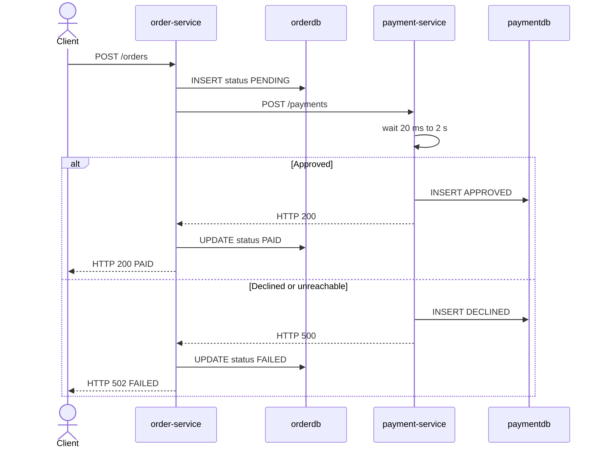
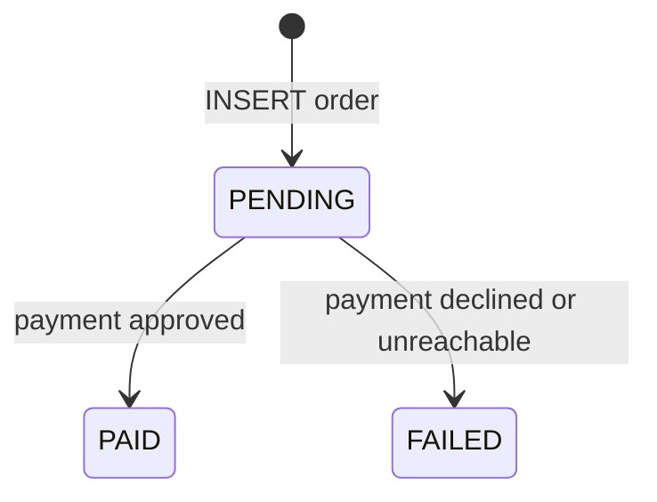
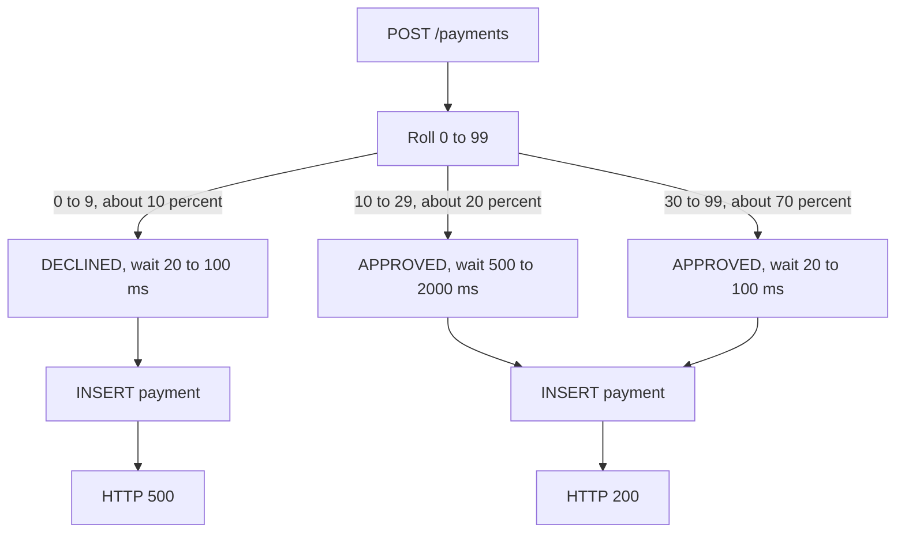
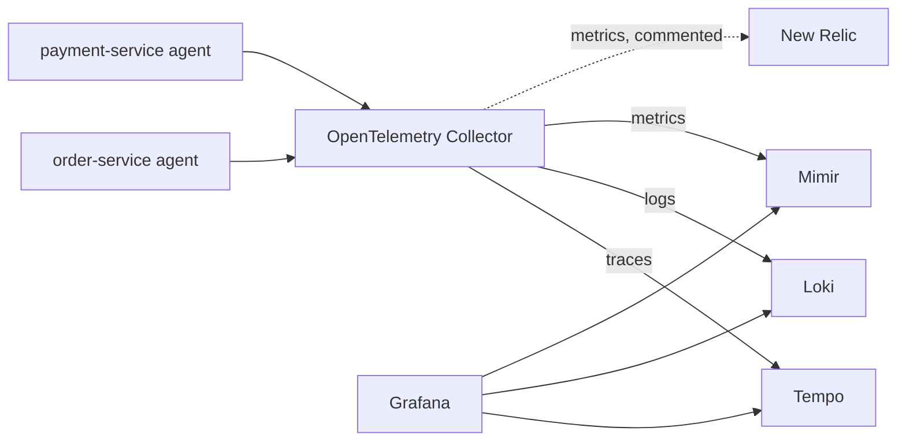
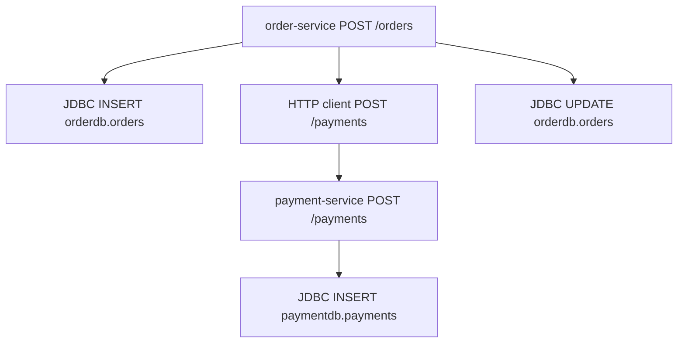

# Order and Payment demo

Two Java 17 Spring Boot services take an order, charge it through a second service, and store each side in its own PostgreSQL database. A Java agent on each JVM sends traces, logs, and metrics to an OpenTelemetry Collector, which forwards them to Tempo, Loki, and Mimir.

## What the services do

**order-service** (`http://localhost:8081`) accepts an order, saves it as `PENDING`, and calls Payment with the order id and amount. When Payment approves the charge, Order updates the row to `PAID` and returns HTTP 200. When Payment declines the charge or cannot be reached, Order updates the row to `FAILED` and returns HTTP 502. The response body is the order either way, including `paymentId` when Payment stored a row.

**payment-service** (`http://localhost:8082`) authorizes one charge. It rolls a random outcome, waits, then inserts the payment. An approval returns HTTP 200. A decline is stored as `DECLINED` and returned as HTTP 500 so the Java agent marks that span as an error.

Each service owns one database on the shared PostgreSQL server:

| Database | Table | Written by |
| --- | --- | --- |
| `orderdb` | `orders` | order-service |
| `paymentdb` | `payments` | payment-service |

`orders` holds `id`, `customer_id`, `sku`, `amount`, `status` (`PENDING`, `PAID`, `FAILED`), `payment_id`, and `created_at`. `payments` holds `id`, `order_id`, `amount`, `status` (`APPROVED`, `DECLINED`), `delay_ms`, and `created_at`.

## Request path



If Payment cannot be reached, there is no payment row. Order still stores `FAILED` with a null `paymentId`.



## Payment outcomes



The wait sits inside the Payment HTTP span, before the `INSERT`. A slow approval shows up as a long Payment span with a short database span underneath it. Payment logs `orderId`, `paymentId`, `status`, and `delayMs`.

## APIs

`POST /orders` body:

```json
{ "customerId": "c-1", "sku": "book", "amount": 42.50 }
```

`customerId` and `sku` must be non-blank, and `amount` must be at least `0.01`. Anything else returns HTTP 400.

`GET /orders/{id}` returns the stored order. `GET /payments/{id}` returns the stored payment. An unknown id returns HTTP 404.

`POST /payments` is what Order calls. Body: `{ "orderId", "amount" }`.

## Telemetry



The agent is attached on the JVM command line in each image. Both processes export OTLP HTTP to `otel-collector:4318`. The Collector batches that data and sends traces to Tempo, logs to Loki, and metrics to Mimir.

Each pipeline can list more than one exporter. The metrics pipeline in `otel-collector/config.yaml` includes a commented `otlp_http/newrelic` exporter aimed at `https://otlp.nr-data.net`. With that block commented, metrics stay on Mimir. To send the same metrics to New Relic as well:

1. Export an ingest license key: `export NEW_RELIC_LICENSE_KEY=...`
2. In `otel-collector/config.yaml`, uncomment `otlp_http/newrelic` and replace the metrics `exporters` line with the commented fan-out line, `exporters: [otlp_http/mimir, otlp_http/newrelic]`.
3. In `docker-compose.yml`, uncomment the Collector `NEW_RELIC_LICENSE_KEY` environment entry.
4. Recreate the Collector: `docker compose up -d otel-collector`.

For an EU account, change the endpoint to `https://otlp.eu01.nr-data.net`. The same exporter can be added to the traces or logs pipeline when those signals should go to New Relic too. Mimir continues to receive metrics either way.

A paid order trace looks like this:



On a decline, `POST /orders`, the client call, and `POST /payments` have error status. The SQL spans stay successful because the `FAILED` and `DECLINED` rows were written.

## Metrics in Mimir

These are the metrics the two Java agents exported and Mimir stored. The service name is the `job` label, `order-service` or `payment-service`. A histogram is three series: `_bucket`, `_count`, and `_sum`.

Tempo writes a separate set from the traces it receives: `traces_spanmetrics_*` and `traces_service_graph_*`. Those series use the label `service` rather than `job`. The dashboard's service-graph and SQL-latency panels read them. They are not in the tables below.

### HTTP

| Metric | Type | Unit | Seen on | Description |
| --- | --- | --- | --- | --- |
| `http_server_request_duration` | histogram | seconds | both | Time to handle an incoming request. Labels include `http_route`, `http_request_method`, `http_response_status_code`, and `error_type` on failures. Seen routes: `POST /orders` at 200, 400, and 502, and `POST /payments` at 200 and 500. |
| `http_client_request_duration` | histogram | seconds | order-service | Time for Order's call to Payment. `server_address` is `payment-service` and `server_port` is `8080`. Seen statuses are 200 and 500. |

### PostgreSQL connection pool

The agent records the HikariCP pool. `pool_name` is `postgres:5432/orderdb` on Order and `postgres:5432/paymentdb` on Payment.

| Metric | Type | Unit | Description |
| --- | --- | --- | --- |
| `db_client_connections_usage` | gauge | connections | Open connections, split by `state` `idle` or `used`. |
| `db_client_connections_max` | gauge | connections | Configured maximum pool size. |
| `db_client_connections_idle_min` | gauge | connections | Configured minimum number of idle connections. |
| `db_client_connections_pending_requests` | gauge | requests | Threads waiting to borrow a connection. |
| `db_client_connections_wait_time` | histogram | milliseconds | Time spent waiting to borrow a connection. |
| `db_client_connections_use_time` | histogram | milliseconds | Time a connection stayed checked out. |
| `db_client_connections_create_time` | histogram | milliseconds | Time to open a new physical connection. |

SQL statement latency is the Tempo span metric `traces_spanmetrics_latency`, filtered to `INSERT`, `UPDATE`, and `SELECT` span names.

### JVM

Both services report the same JVM metrics. Memory series are split by `jvm_memory_pool_name` and `jvm_memory_type` (`heap` or `non_heap`).

| Metric | Type | Unit | Description |
| --- | --- | --- | --- |
| `jvm_memory_used` | gauge | bytes | Bytes currently used in each pool. |
| `jvm_memory_committed` | gauge | bytes | Bytes committed to each pool. |
| `jvm_memory_limit` | gauge | bytes | Maximum size of pools that have a fixed limit. G1 Eden and survivor have no series here. |
| `jvm_memory_used_after_last_gc` | gauge | bytes | Heap still in use after the latest collection, for Eden, survivor, and old generation. |
| `jvm_gc_duration` | histogram | seconds | Garbage-collection pause time. The seen series is `G1 Young Generation` with action `end of minor GC`. |
| `jvm_thread_count` | gauge | threads | Live platform threads, by `jvm_thread_state` and `jvm_thread_daemon`. |
| `jvm_class_count` | gauge | classes | Classes currently loaded. |
| `jvm_class_loaded` | counter | classes | Classes loaded since the JVM started. |
| `jvm_class_unloaded` | counter | classes | Classes unloaded since the JVM started. |
| `jvm_cpu_count` | gauge | processors | Processors available to the JVM. |
| `jvm_cpu_recent_utilization` | gauge | ratio | Recent process CPU use, from 0 to 1. |
| `jvm_cpu_time` | counter | seconds | CPU time the process has used since it started. |

### Agent export

These describe the agent's own pipeline. `type` on the exporter counters is `span`, `metric`, or `log`.

| Metric | Type | Description |
| --- | --- | --- |
| `otlp_exporter_seen` | counter | Items the OTLP exporter accepted, by `type`. |
| `otlp_exporter_exported` | counter | Items the exporter sent, by `type` and `success`. |
| `processedSpans` | counter | Spans handled by `BatchSpanProcessor`. `dropped=true` marks spans the processor discarded. |
| `processedLogs` | counter | Log records handled by `BatchLogRecordProcessor`, with the same `dropped` label. |
| `queueSize` | gauge | Items waiting in the span processor or the log processor. |
| `target_info` | gauge | Always `1`. Resource attributes are labels, including `deployment_environment=demo`, `service_version`, the Java runtime, and `telemetry_distro_version` for the agent. |

## Run

Start the Grafana stack in `../observability` first. It creates the Docker network this file joins.

```bash
cd /mnt/c/Users/gbhosal/git/opentelemetry-tutorial/observability
docker compose up -d

cd /mnt/c/Users/gbhosal/git/opentelemetry-tutorial/services
docker compose up -d --build
```

| Service | URL |
| --- | --- |
| Order | http://localhost:8081 |
| Payment | http://localhost:8082 |
| PostgreSQL | `localhost:5432`, user `demo`, password `demo`, databases `orderdb` and `paymentdb` |
| Collector OTLP | `localhost:4317` (gRPC), `localhost:4318` (HTTP) |
| Grafana | http://localhost:3000 |

Place one order:

```bash
curl -sS -X POST http://localhost:8081/orders \
  -H 'Content-Type: application/json' \
  -d '{"customerId":"c-1","sku":"book","amount":42.50}'
```

Place a batch so the fast, slow, and declined cases all show up:

```bash
bash place-orders.sh 20
```

Read that many orders back. The script places the orders, then calls `GET /orders/{id}` for each id:

```bash
bash get-orders.sh 20
```

The provisioned dashboard is [Order and Payment](http://localhost:3000/d/otel-order-payment/order-and-payment). The headline counts and latency percentiles are totals since each service started. Charts, logs, and traces follow the time picker, so keep it on the last few hours after a batch of orders. Panels cover request volume and HTTP status, server and client latency, the Order to Payment to PostgreSQL edges, SQL span latency, connection pools, JVM, application logs, and recent `POST /orders` traces.

In Grafana Explore:

- Tempo: `{ resource.service.name = "order-service" && name = "POST /orders" }`
- Loki: `{service_name="payment-service"}`
- Mimir: `sum by (job, http_route, http_response_status_code) (http_server_request_duration_count)`

Open a trace and follow its logs link. The Payment log line for that trace includes `delayMs`.

```bash
docker compose stop
docker compose down    # add -v to drop the Postgres volume
```
